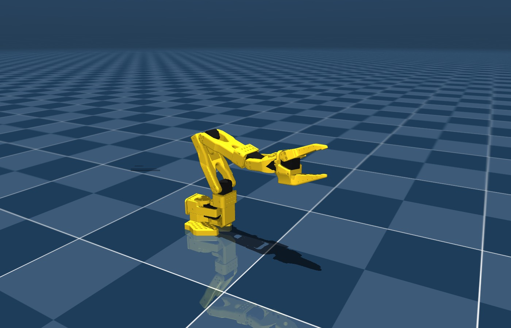
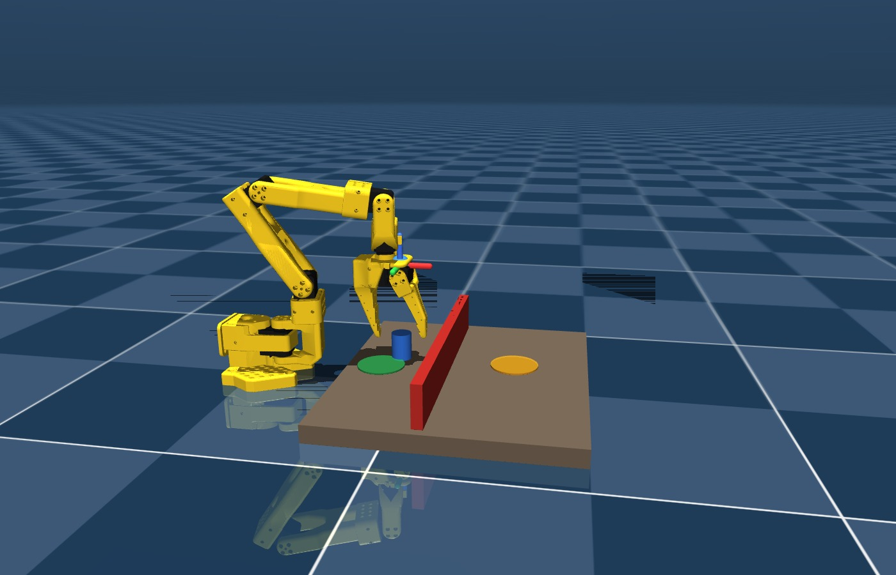
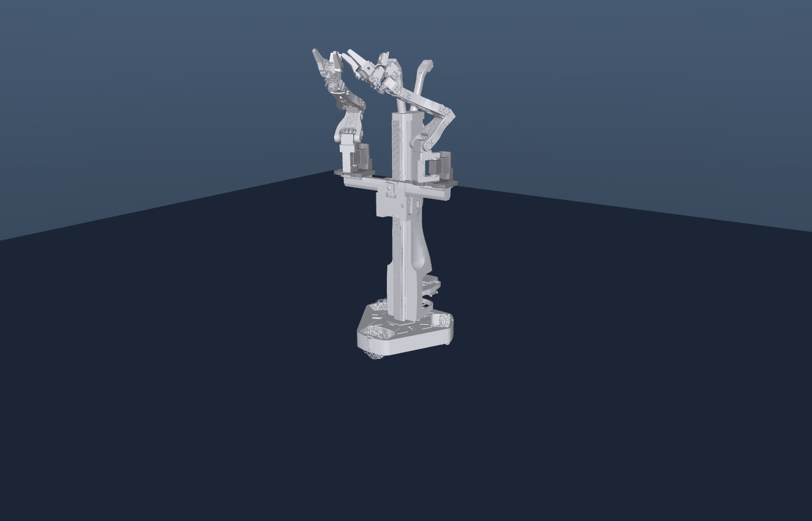
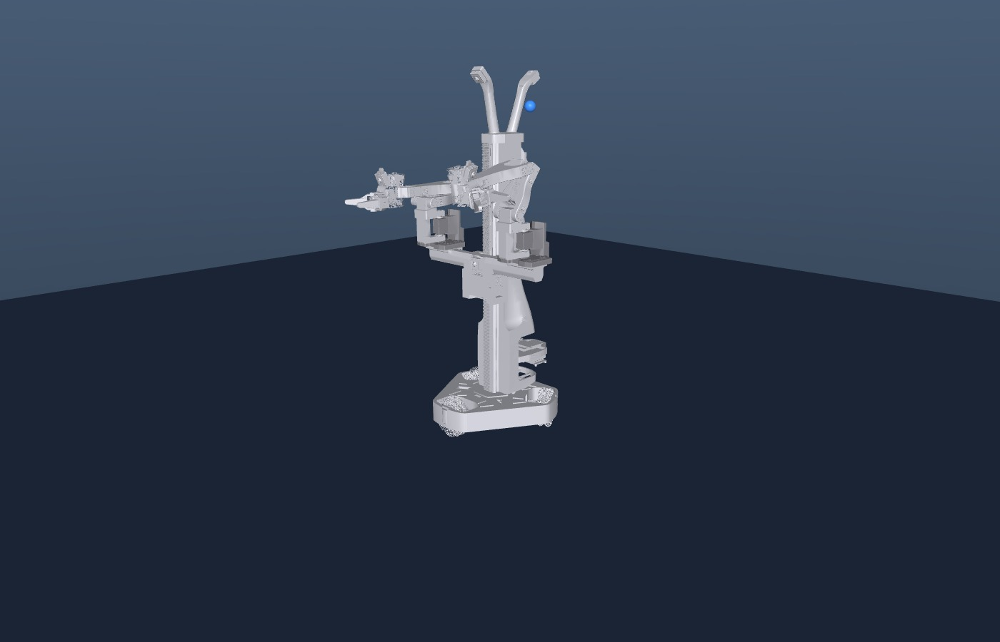

# Robo ARM(s) Gym

MuJoCo gyms for a single desk arm and a dual-arm mobile robot. Same skill contract, same train gate.

<p align="center">
  
  
</p>
<p align="center">
  
  
</p>

| | |
| --- | --- |
| **Arm** | SO-101. Six joints. Reach, place, and barrier. |
| **Task** | Barrier: pick the can, clear the fence, set it down. Touching the fence fails. Scripted policy, 50/50. |
| **Arms** | AlohaMini2. Two arms, a lift, and a base. The gym that runs today moves the left arm only. |
| **Aloha reach** | Blue marker is the target. Base, lift, right arm, and left gripper stay fixed. |

## Try it

```bash
pip install -e .
python -m twin eval --skill barrier --policy scripted --episodes 50
python -m twin eval --skill aloha-reach --policy scripted --episodes 20
```

Both run on a CPU, including a Mac. Isaac Lab is not in this repository.

Reach on the SO-101 is not certified. The sampler still places targets behind the arm, and the last measured score is 26/50.

## Submit a skill

A pull request may add or change only:

- `skills/<name>/skill.yaml`
- `skills/<name>/reward.py`
- `policies/<name>/*.zip`

Comment `/train` or add the label `train-on-node`. The job runs only after Snyk Open Source and a LiteLLM probe that got an answer from Node D with the GPU card free. The merge bar is in the skill manifest: at least 80% over 50 episodes.

[GOVERNANCE.md](GOVERNANCE.md) · [CONTRIBUTING.md](CONTRIBUTING.md)

## Skills

| Skill | What passes | Policy in this tree |
| --- | --- | --- |
| `barrier` | Can on pad B, jaw open, fence untouched | Scripted, 50/50 |
| `place` | Block on pad B, jaw open | Scripted, 50/50 |
| `reach` | End-effector within 2 cm | Not certified, 26/50 |
| `aloha-reach` | Left wrist site within 2 cm | Not certified |

## Layout

| Path | What it is |
| --- | --- |
| `twin/` | Gymnasium envs, scripted policies, train and eval |
| `skills/` | Manifest, schema, and registry |
| `urdf/so101/` | SO-101 model |
| `urdf/alohamini2/` | AlohaMini2 URDF and meshes |
| `governance/` | Diff guard, LiteLLM admit, certificate |
| `docs/images/` | Stills on this page |
| `videos/twin/` | Barrier demo |

SO-101 meshes and URDF: [TheRobotStudio/SO-ARM100](https://github.com/TheRobotStudio/SO-ARM100), commit `a758567`, Apache-2.0. AlohaMini2: [liyiteng/AlohaMini](https://github.com/liyiteng/AlohaMini), commit `17c6a98`, Apache-2.0. See `NOTICE`.
