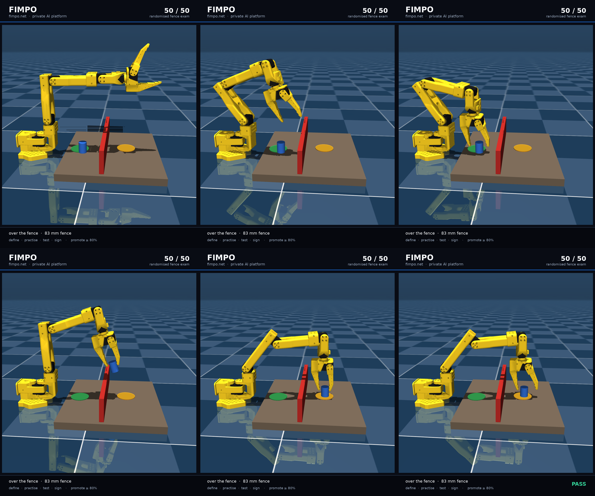

# Robo ARM(s) Gym

A MuJoCo gym for the SO-101 arm, with three skills and a train gate.

The barrier job is the one to watch. Pick up the can, lift it over a fence, set it down. Touching the fence fails the episode. The scripted policy passes 50 of 50 episodes. A straight-line policy hits the fence.



Reach is not certified. The sampler still places targets behind the arm, and the last measured score is 26/50.

## Try it

```bash
pip install -e .
python -m twin eval --skill barrier --policy scripted --episodes 50
```

That runs on a Mac or a Linux CPU. Isaac Lab is not part of this repository.

## Submit a skill

A pull request may add or change only:

- `skills/<name>/skill.yaml`
- `skills/<name>/reward.py`
- `policies/<name>/*.zip`

Comment `/train` or add the label `train-on-node`. The job runs only after Snyk Open Source and a LiteLLM probe that got an answer from Node D with the GPU card free. The merge bar is the one in the skill manifest: at least 80% over 50 episodes.

Read [GOVERNANCE.md](GOVERNANCE.md) for the certificate and [CONTRIBUTING.md](CONTRIBUTING.md) for the diff rules.

## Skills

| Skill | What passes | Policy in this tree |
| --- | --- | --- |
| `barrier` | Can on pad B, jaw open, fence untouched | Scripted, 50/50 |
| `place` | Block on pad B, jaw open | Scripted, 50/50 |
| `reach` | End-effector within 2 cm | Not certified, 26/50 |
| `aloha-reach` | Left AlohaMini2 arm within 2 cm. Base, lift, and right arm fixed | Not certified |

## Layout

| Path | What it is |
| --- | --- |
| `twin/` | Gymnasium envs, scripted policies, train and eval |
| `skills/` | Manifest, schema, and registry |
| `urdf/so101/` | SO-101 model |
| `urdf/alohamini2/` | AlohaMini2 URDF and meshes |
| `governance/` | Diff guard, LiteLLM admit, certificate |
| `videos/twin/` | Barrier demo |

The SO-101 meshes and URDF are from [TheRobotStudio/SO-ARM100](https://github.com/TheRobotStudio/SO-ARM100) at commit `a758567`, Apache-2.0. AlohaMini2 is from [liyiteng/AlohaMini](https://github.com/liyiteng/AlohaMini) at commit `17c6a98`, also Apache-2.0. See `NOTICE`.

```bash
python -m twin eval --skill aloha-reach --policy scripted --episodes 20
```
